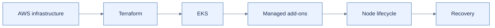

# Part II — AWS and Infrastructure

Infrastructure as code describes resources, while the AWS APIs and Kubernetes ecosystem determine what operations are actually supported. EKS upgrades illustrate why a Terraform provider's capabilities, AWS rollback rules, node compatibility and add-on lifecycle must be evaluated independently.

## Published chapter
[EKS rollback and Terraform — overview](../../engineering-reference/guides/aws/eks-upgrade-rollback/README.md) → [detailed analysis](../../engineering-reference/guides/aws/eks-upgrade-rollback/details.md).

## Further subjects
Terraform modules and workspaces, EKS managed node groups, launch templates, Karpenter, IAM/IRSA and EKS add-on compatibility are candidates for future chapters, not yet complete.

[← Foundations](../01-foundations/README.md) · [Next: Containers and CI/CD →](../03-cicd/README.md)
