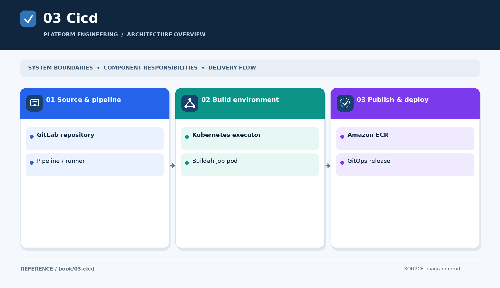

# Part III — Containers and CI/CD

A CI job is a workload with compute privileges, cloud identity and network access. Container builds must distinguish **how an image is built**, **how the job authenticates to push it**, and **how Kubernetes authenticates to pull it**.

## Published chapter
[Buildah with GitLab Kubernetes executor and ECR — overview](../../engineering-reference/guides/gitlab/kubernetes-runner-buildah-ecr/README.md) → [detailed analysis](../../engineering-reference/guides/gitlab/kubernetes-runner-buildah-ecr/details.md).

See also [privileged runner isolation](../../engineering-reference/guides/security/privileged-gitlab-runners/README.md).

## Further subjects
GitLab Runner Helm values, OIDC/IRSA, rootless Podman, registry mirrors and pipeline testing remain future chapter candidates.

[← Infrastructure](../02-infrastructure/README.md) · [Next: GitOps →](../04-gitops/README.md)
