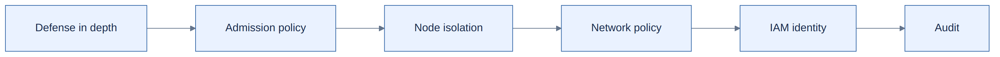

# Part V — Security

Security controls operate at different boundaries: Kyverno governs admission, Calico/Cilium govern allowed network traffic, IRSA governs AWS permissions, and node isolation limits co-tenancy. None alone makes privileged DinD equivalent to an unprivileged workload.

## Published chapter
[Privileged GitLab runners and DinD — overview](../../engineering-reference/guides/security/privileged-gitlab-runners/README.md) → [detailed analysis](../../engineering-reference/guides/security/privileged-gitlab-runners/details.md).

For software supply-chain lifecycle risks, continue to [EOL inventory](../../engineering-reference/guides/security/kubernetes-workload-eol-inventory/README.md).

[← GitOps](../04-gitops/README.md) · [Next: Operations →](../06-operations/README.md)
