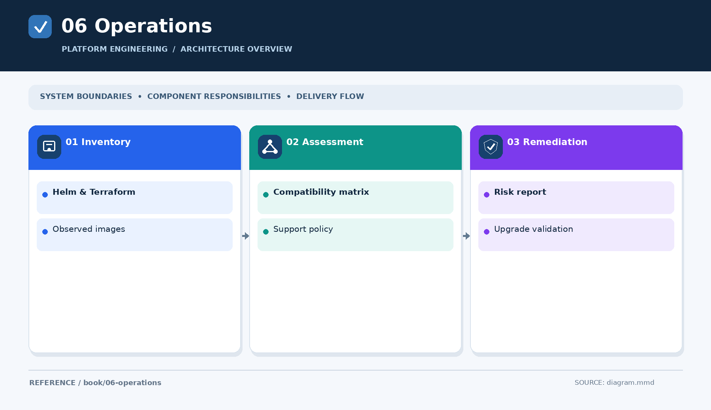

# Part VI — Operations and Lifecycle

An EKS platform has multiple release clocks: Kubernetes, add-ons, controllers, Helm charts, deployed applications, images and node operating systems. Operational safety requires knowing both what Git declares and what the cluster actually runs.

## Published chapter
[Flux, Helm, Terraform and EKS EOL inventory — overview](../../engineering-reference/guides/security/kubernetes-workload-eol-inventory/README.md) → [detailed analysis and validation](../../engineering-reference/guides/security/kubernetes-workload-eol-inventory/details.md).

Related reading: [EKS upgrade and rollback](../../engineering-reference/guides/aws/eks-upgrade-rollback/README.md).

[← Security](../05-security/README.md) · [Next: Practice →](../07-practice/README.md)
