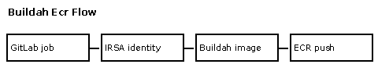

# Part VII — Practical Labs and Reusable Work

[Open the overview PNG](diagram.png)

The handbook explains **why** and **what**. Tested implementations should show **how**, with prerequisites, runnable commands, expected output and cleanup.

| Destination | Purpose | Current status |
| --- | --- | --- |
| [Labs](../../labs/README.md) | Multi-component end-to-end scenarios | Proposed lab catalog; do not assume implementations exist |
| [Modules](../../modules/README.md) | Reusable infrastructure building blocks | Structure and conventions |
| [Tooling](../../tooling/README.md) | Scripts, container images and development assets | Structure and conventions |

When adding a working lab, link it from the relevant book chapter and topic guide. Keep source code in its original reusable location rather than copying it into prose.

[← Operations](../06-operations/README.md) · [Back to glossary](../../README.md)
