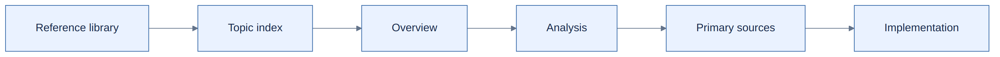

# Engineering reference

[Open the overview PNG](diagram.png)

**Browse by concept:** [Platform engineering glossary](../README.md) → [topic index](INDEX.md) → overview → detailed analysis.

This area contains platform-engineering research and design notes, not raw chat transcripts. Topic `README.md` files explain the problem and outcome briefly; `details.md` files contain analysis, validation and source links. Executable work belongs in [labs](../labs/), [modules](../modules/) or [tooling](../tooling/).

| Topic | Short overview |
| --- | --- |
| [Privileged GitLab runners](guides/security/privileged-gitlab-runners/README.md) | DinD risks and isolation priorities |
| [Buildah and ECR](guides/gitlab/kubernetes-runner-buildah-ecr/README.md) | Secure image building and AWS authentication |
| [EOL inventory](guides/security/kubernetes-workload-eol-inventory/README.md) | Flux, Helm, Terraform and EKS lifecycle coverage |
| [EKS rollback](guides/aws/eks-upgrade-rollback/README.md) | Upgrade recovery and Terraform support |

Follow [content standards](references/content-standards.md) and publish only independently developed, non-sensitive material.
