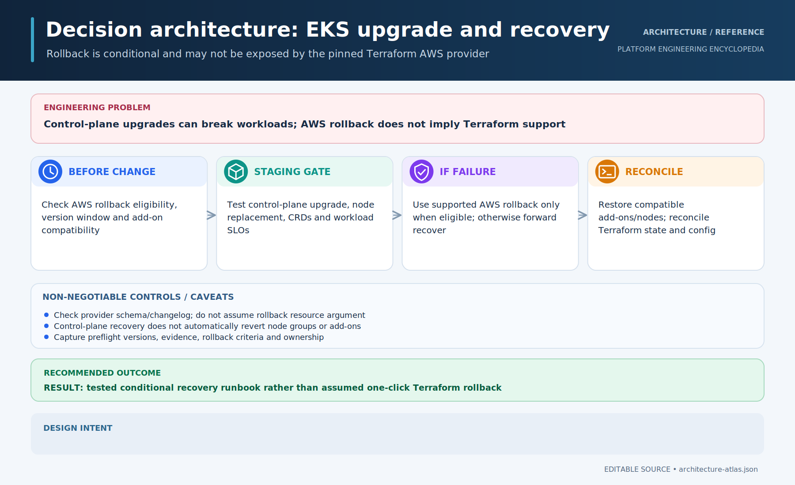

# EKS rollback and Terraform

[← Glossary](../../../../README.md) · [Topic index](../../../INDEX.md)

## Problem
An EKS version upgrade may introduce incompatibilities; AWS rollback availability does not imply Terraform provider support.

## Conclusion
Verify AWS rollback eligibility and the pinned Terraform provider's capabilities, and maintain a tested workload and add-on recovery plan.

## Ranked recommendations
| Priority | Recommendation | Impact |
| --- | --- | --- |
| P0 | Confirm AWS rollback prerequisites and constraints | Avoid unsupported recovery assumptions |
| P1 | Check the pinned Terraform provider schema | Distinguish API and provider capabilities |
| P1 | Test workload, node and add-on recovery | Control-plane rollback is not complete recovery |
| P2 | Reconcile Terraform after any out-of-band action | Prevent drift |

## Go deeper
[Detailed analysis, validation and references](details.md) · [Related topic index](../../../INDEX.md)

*Research summary; implementation and runtime validation are not implied.*
