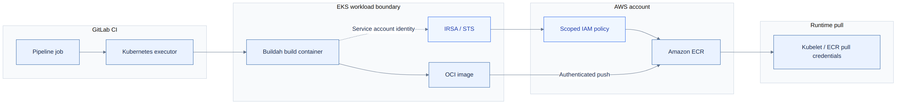

# Buildah and ECR on GitLab Kubernetes executor

[← Glossary](../../../../README.md) · [Topic index](../../../INDEX.md)

[Open the solution PNG](diagram.png) · [Open scalable SVG](diagram.svg)

**Diagram focus:** recommended rootless Buildah workflow, separate pull/push authentication, IRSA trust path, and proof of least privilege.

## Problem
CI image builds require ECR authentication without static AWS credentials or unnecessary privileged DinD.

## Conclusion
Use least-privilege IRSA and verify Buildah rootless behavior, image-pull authentication and ECR push authentication separately.

## Ranked recommendations
| Priority | Recommendation | Impact |
| --- | --- | --- |
| P0 | Use dedicated least-privilege IRSA service accounts | Avoid static credentials |
| P1 | Validate rootless Buildah on the target cluster | Reduce host exposure |
| P1 | Test AWS CLI ECR login or verified credential-helper support | Ensure working short-lived auth |
| P2 | Pin build image versions and enforce scoped egress | Improve repeatability |

## Go deeper
[Detailed analysis, validation and references](details.md) · [Related topic index](../../../INDEX.md)

*Research summary; implementation and runtime validation are not implied.*
