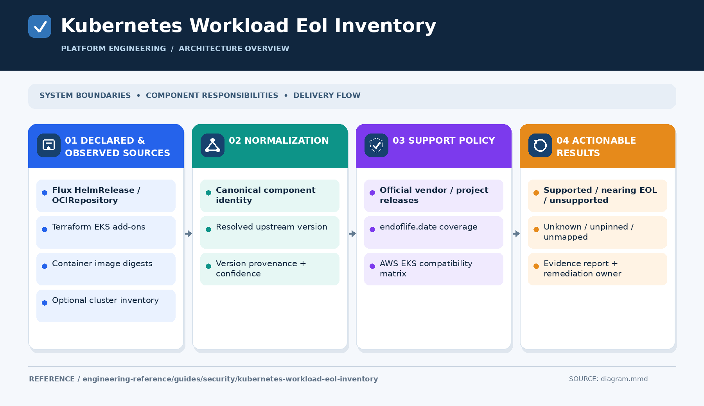

# EOL scanning across Flux, Helm, Terraform and EKS

[← Glossary](../../../../README.md) · [Topic index](../../../INDEX.md)

[Open the overview PNG](diagram.png)

## Problem
A Flux repository may deploy unsupported applications and add-ons even when Helm charts are pinned.

## Conclusion
Resolve chart, app, image and add-on versions independently. Scan desired state and optionally compare with running EKS workloads; treat unmapped dependencies as visible coverage gaps.

## Ranked recommendations
| Priority | Recommendation | Impact |
| --- | --- | --- |
| P0 | Inventory rendered images and resolve app versions | Prevent false lifecycle conclusions |
| P0 | Check installed EKS add-ons against AWS compatibility data | Identify incompatibilities |
| P1 | Support Flux references, Terraform parsing and distinct unknown statuses | Improve coverage and accuracy |
| P1 | Preserve GitLab CI failures and publish auditable reports | Make findings actionable |
| P2 | Schedule scans and automate proposed upgrades | Reduce remediation delay |

## Go deeper
[Detailed analysis, validation and references](details.md) · [Related topic index](../../../INDEX.md)

*Research summary; implementation and runtime validation are not implied.*
