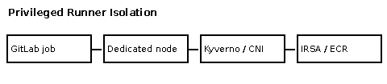

# Privileged GitLab runners and DinD

[← Glossary](../../../../README.md) · [Topic index](../../../INDEX.md)

[Open the overview PNG](diagram.png)

## Problem
Privileged Docker-in-Docker jobs can compromise node isolation; Kubernetes namespaces alone do not remove host-level risk.

## Conclusion
Prefer verified unprivileged builds. If privileged jobs remain necessary, isolate them on dedicated disposable nodes with narrowly scoped admission, network and IAM controls.

## Ranked recommendations
| Priority | Recommendation | Impact |
| --- | --- | --- |
| P0 | Prefer rootless Buildah/BuildKit where supported | Reduce privileged execution |
| P0 | Use dedicated tainted and short-lived nodes | Limit co-tenancy and persistence |
| P1 | Enforce Kyverno exception scoping and Calico/Cilium network policy | Reduce lateral movement |
| P1 | Limit IRSA and registry access | Reduce cloud and network blast radius |

## Go deeper
[Detailed analysis, validation and references](details.md) · [Related topic index](../../../INDEX.md)

*Research summary; implementation and runtime validation are not implied.*
