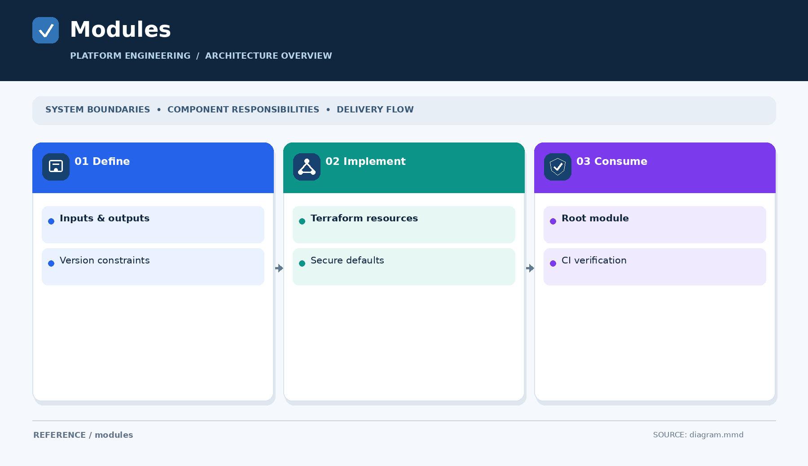

# Reusable modules

[Open the overview PNG](diagram.png)

Use this directory for reusable, tested components shared by multiple labs. A module should have clear inputs/outputs or interfaces, a README with usage examples, version constraints where applicable, and a verification method.

- [Terraform modules](terraform/) — reusable infrastructure modules; no published modules yet.

Prefer a small independent module over copying configuration into multiple labs. Do not publish account-specific or employer-derived settings.
