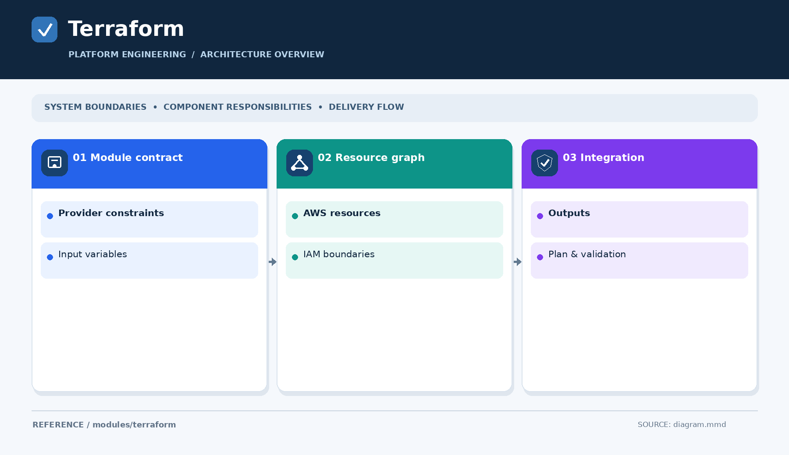

# Terraform modules

[Open the overview PNG](diagram.png)

Store reusable Terraform modules here when they have actual implementations. Include `main.tf`, `variables.tf`, `outputs.tf`, `versions.tf` as appropriate, plus a README and a working synthetic example or test.

There are no implemented modules yet. Experiment-specific infrastructure belongs in [labs](../../labs/), and conceptual Terraform walkthroughs belong in [engineering-reference/guides/terraform](../../engineering-reference/guides/terraform/).
