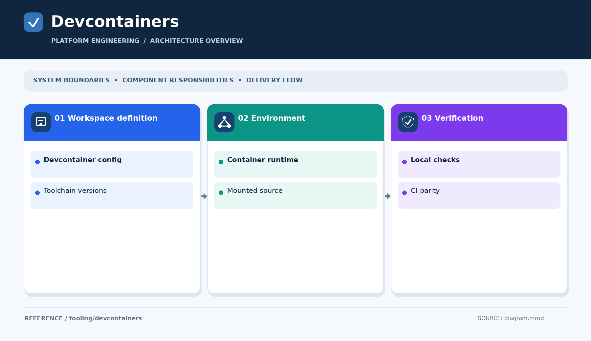

# Development containers

[Open the overview PNG](diagram.png)

Store reusable `devcontainer.json` configurations and supporting images for browser-based development when they are ready.

No development containers are implemented yet. Document base images, CLI versions, privileges, and how environments can be recreated without embedding credentials.
